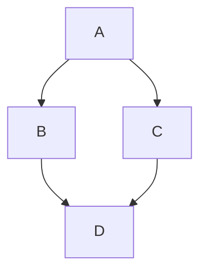

code如下
```markdown
    ```mermaid
    graph TD;
        A-->B;
        A-->C;
        B-->D;
        C-->D;
    ```
```

## 修改CodeBlock
```js
function CodeBlock({ language, node, inline, className, children, ...props }: any) {
  const { onCopy, value, setValue, hasCopied } = useClipboard(children);
  const match = /language-(\w+)/.exec(className || '');
  const lang = match![1] 
  if (inline&&!match) { //只有一行的code
    return (<Flex mb={2}>
      <Code {...props} colorScheme="blackAlpha">
        {children}
      </Code>
      <Button ml={2} onClick={onCopy} colorScheme='blue' variant='outline'>{hasCopied ? "Copied!" : "Copy"}</Button>
    </Flex>)
  } else if (lang==='mermaid') {
    return (<Box className='mermaid'>{children}</Box>)
  } else {
    return (
      <Flex mb={2}>
        <SyntaxHighlighter
          style={darcula as { [key: string]: CSSProperties }}
          language={lang}
          PreTag="div"
          {...props}
        >
          {String(children).replace(/\n$/, '')}
        </SyntaxHighlighter>
        <Button ml={2} onClick={onCopy} colorScheme='blue' variant='outline'>{hasCopied ? "Copied!" : "Copy"}</Button>
      </Flex>
    )
  }
}
```
## 成功
以下圖是使用 mermaidjs渲染出來的

- https://github.blog/2022-02-14-include-diagrams-markdown-files-mermaid/
- https://nextjs.org/docs/pages/api-reference/components/script
- http://mermaid.js.org/