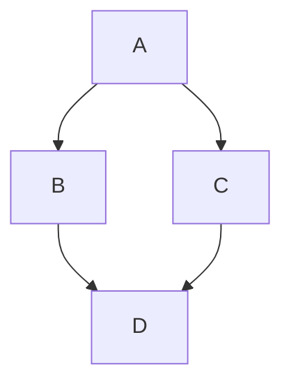

# h1
text text text text text text text text text text text text text text text text text text text text text text 
text text text text text text text text text text text text text text text text text text text text text text 
## h2
### h3
## abc abc
## abc + abc
## code
hello
```js
const main = () => console.log("hello")
main();
```
## one line code
`rm -rf`
## flowchart
